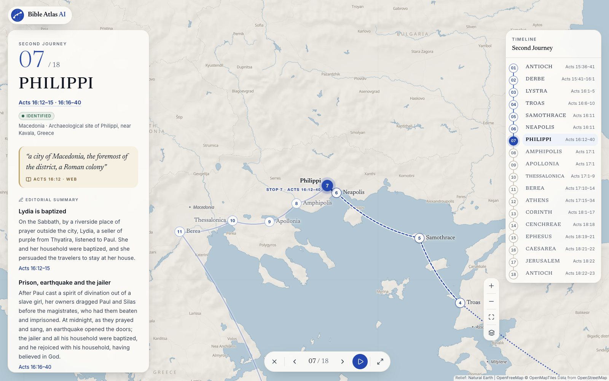
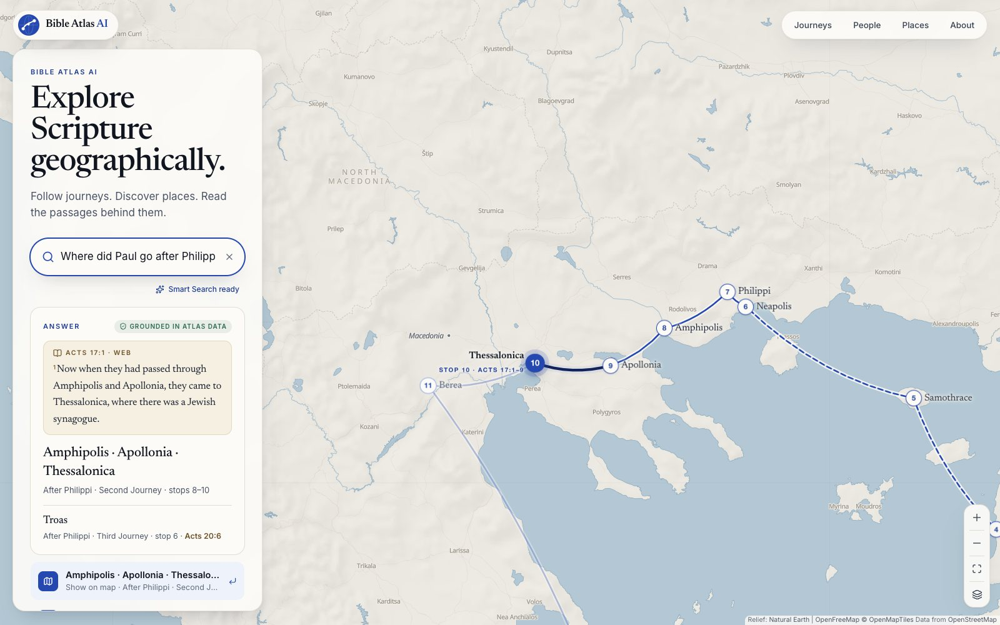
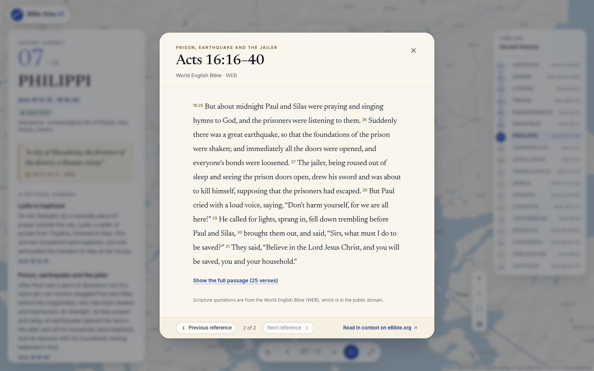
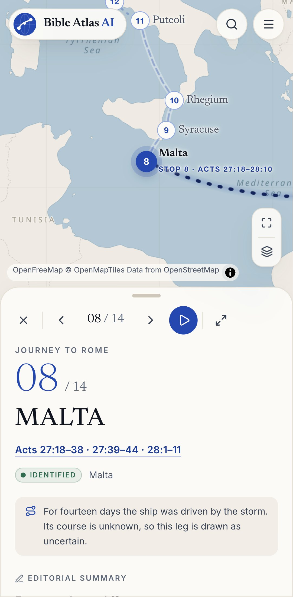
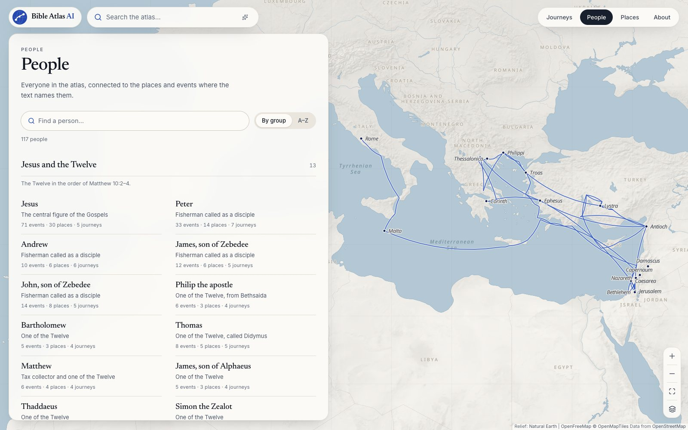
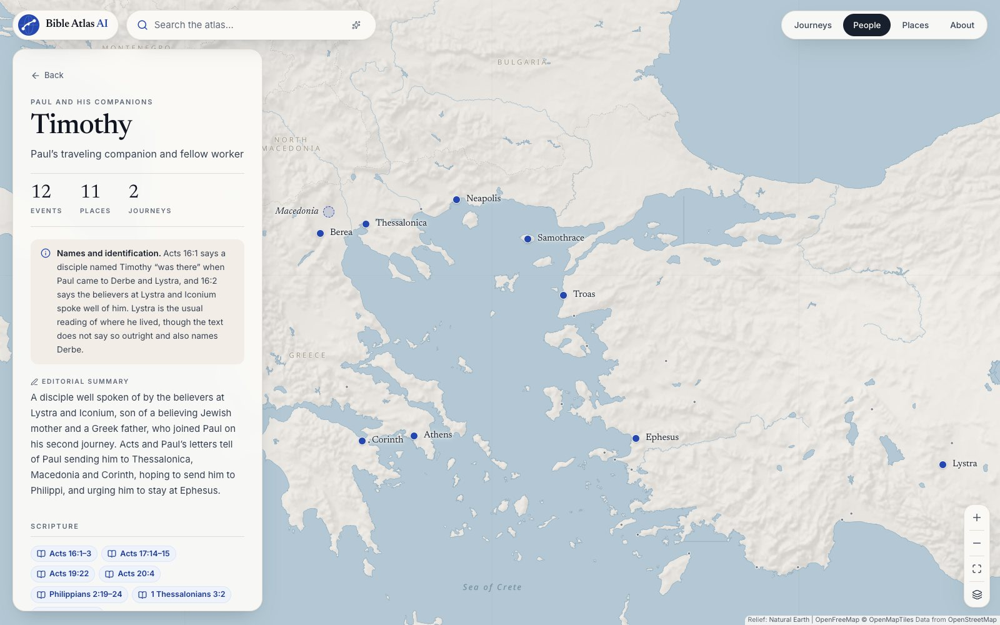
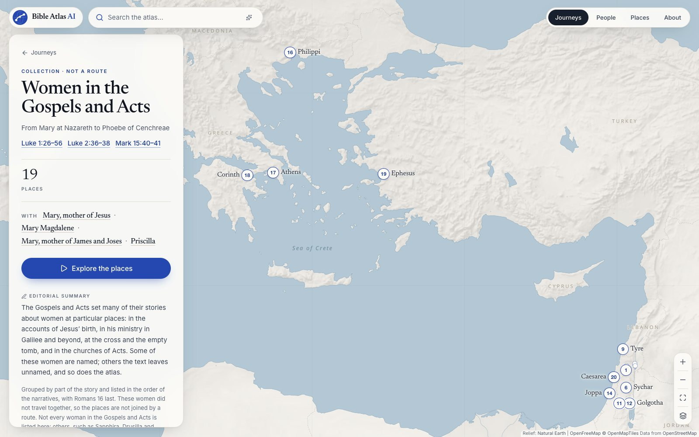

# Bible Atlas AI

**Explore Scripture geographically.** Follow Paul's journeys across the Mediterranean, see where the Gospel events took place, and read the passage behind every stop: on an interactive atlas, with on-device AI search.



<!-- Add the live link here after deploying. -->

## Highlights

- **A map with an interface, not the other way round.** A light atlas fills the screen: warm stone land, a muted Aegean sea, quiet modern labels, biblical places named in italic, and a cobalt route. The interface floats over it in editorial cards.
- **Journeys you can step through.** Choosing a journey pulls the map back and draws the route stop by stop, with its figures derived from the data ("18 stops · ≈ 3,650 km approximate mapped distance"). *Begin Journey* opens Journey Mode: one stop at a time, the passages behind it, a verbatim line from the text, an editorial timeline, playback, keyboard control and a full-screen presentation view.
- **Accuracy you can see.** Stops follow the order the text narrates. Each place carries a certainty label (identified, probable, traditional, debated, approximate) with its reason, and route lines show *how* the text describes each leg: by sea (dashed), overland or unstated (solid), implied or unknown (dotted).
- **Scripture first.** Passages open on a vellum reading page, quoted verbatim from the public-domain World English Bible with book, chapter, verse and translation. Editorial summaries are labelled and set apart.
- **Answers grounded in the atlas.** Search understands references and questions ("Acts 16", "Where did Paul go after Philippi?") and leads with the verse: Acts 17:1 names Amphipolis, Apollonia and Thessalonica, so the answer gives all three, and the map flies to them. An optional sentence-embedding model runs entirely in the browser. Questions the data cannot answer get relevant results, never a guess.
- **Every way in.** The home screen indexes the atlas, with counts read from the data: journeys and collections, places, people and events. Each opens a directory that works without the map. The Events directory lists every event in the order of the Bible, with its passage, places, people and journey stop.
- **People, from the text.** A directory of 117 people, with the original Twelve and Matthias kept distinct. Each person's page shows their names and how they are identified, the counts, journeys and connected people derived from the events, and where their story unfolds on the map.
- **Shareable, fast and accessible.** Every journey, stop, place and person has its own pre-rendered URL with a social preview. Phones get a draggable sheet and full-screen search. Keyboard and screen-reader use, reduced motion and WCAG contrast are covered by automated tests.

| Search with a grounded answer | Scripture reader | Phone |
| --- | --- | --- |
|  |  |  |

| People directory | A person: Timothy | A collection: women in the Gospels and Acts |
| --- | --- | --- |
|  |  |  |

## What's in the atlas

| | |
| --- | --- |
| Routes (6) | Paul's first, second and third missionary journeys, his arrest and trials, and his voyage to Rome; Philip the evangelist in Acts 8 |
| Collections (9) | The birth and childhood of Jesus; John the Baptist; key places in the ministry of Jesus; the final week in Jerusalem; the resurrection appearances; women in the Gospels and Acts; Jerusalem in Acts; Peter and the early church; Paul's conversion and early ministry. Collections are deliberately **not** drawn as routes |
| Places | 101, each with a sourced coordinate: 72 identified, 5 probable, 3 traditional, 5 debated, and 16 regions shown at an approximate representative point |
| Events | 222, each tied to a passage, a place and the people the passage names |
| People | 117, in seven directory groups, including all of the original Twelve and Matthias |
| Scripture | 933 distinct references (859 in the structured data and 74 more cited in notes), backed by 2,596 verses of the World English Bible from 18 books |

Quality over quantity: the atlas maps the New Testament's journeys carefully rather than the whole Bible loosely. See [DATA_SOURCES.md](DATA_SOURCES.md) for where every kind of information comes from and what remains uncertain.

## How it works

```
                      ┌──────────────────────────── src/data ─────────────────────────────┐
  eBible.org WEB ───► │ scripture/web.json   places/  people/  events/  journeys/          │
  OpenBible.info ───► │ (verbatim verses)    (sourced coordinates, certainty, references)  │
  Pleiades/Wikidata ► │ validate.ts + integrity and content tests                          │
                      └─────────────┬───────────────────────────┬─────────────────────────┘
                                    │                           │
                  ┌─────────────────▼─────────┐      ┌──────────▼───────────────────────┐
                  │ React UI (pre-rendered)   │      │ Search                           │
                  │ cards / bottom sheet      │      │ keyword index + intent parser    │
                  │ Journey Mode, reader      │◄────►│ grounded answers (data only)     │
                  │ MapLibre map (lazy)       │      │ Smart Search worker (optional):  │
                  └───────────────────────────┘      │ MiniLM embeddings via            │
                                                     │ Transformers.js, on device       │
                                                     └──────────────────────────────────┘
```

- **The data is the source of truth.** Content lives in typed modules under `src/data`, never inside components. Relationships are derived from events and stops, so they cannot drift: the people a journey is "with", a person's counts and places, the people at a place. `validate.ts` and the integrity and content tests enforce the rules, from unique ids and valid references to verbatim quotations and the 18 stops of the second journey.
- **Map.** MapLibre GL with OpenFreeMap vector tiles (no API key) and a custom light style. Markers are real buttons rendered through React portals, with a collision pass that keeps labels clear of each other, of the interface and of MapLibre's own labels.
- **Pre-rendered pages.** Every page is rendered at build time, so text appears before any JavaScript runs; the map loads when the page is idle (on a phone's opening view, on the first touch, with a picture of the map until then).
- **Search.** A weighted keyword index (exact, prefix and typo matches) plus intent detection for references, ordinals ("second journey"), people, places, regions, "before/after" and "near". Grounded answers are built from the structured data and always cite passages.
- **Smart Search.** `Xenova/all-MiniLM-L6-v2` (23 MB, Apache-2.0) runs in a Web Worker with Transformers.js and ONNX Runtime (WebAssembly). Document embeddings are precomputed at build time; the browser embeds only the query. The model loads when you first use search (not on page load), respects data-saver mode, and is cached by the browser. If it can't load, keyword search simply carries on.
- **Scripture.** A build script extracts exactly the verses the atlas references from eBible.org's WEB text into a file (about 103 KB gzipped) that loads on demand.

The full design, including the model comparison and the plan for a Claude-powered "Ask Bible Atlas", is in [docs/ARCHITECTURE.md](docs/ARCHITECTURE.md).

## Accuracy principles

1. Scripture is quoted exactly, with book, chapter, verse and translation. Summaries are labelled as editorial.
2. Stops follow the order the text narrates. Where Acts names only a region (Macedonia, Greece) or implies a place without naming it (Jerusalem in Acts 18:22), the atlas says so.
3. Every coordinate cites its source and is checked against it by `npm run data:verify`.
4. Uncertain identifications are labelled, and traditional sites are never presented as established facts.
5. Collections whose places the text doesn't connect (the Gospels' accounts) are not drawn as routes.
6. Where the Gospels differ, the atlas follows the cited passage and points to the parallels instead of harmonizing them.
7. People are named as the text names them. Unnamed people stay unnamed, and later traditional names or identifications (Jude for Thaddaeus, John for the beloved disciple) appear only as tradition.
8. Counts and relationships are always computed from the data, never typed by hand.
9. Questions the data can't answer get relevant results, not a generated answer.

Event, person and place summaries were drafted with AI assistance, checked against the cited passages by automated tests (verbatim quotations, references, relationships) and by separate reviews of each area. Known limitations and items worth a human expert's review are listed in [DATA_SOURCES.md](DATA_SOURCES.md#known-limitations).

## Tech stack

React 19 · TypeScript (strict) · Vite 8 · Tailwind CSS 4 · MapLibre GL JS 6 · OpenFreeMap · Transformers.js 4 · Lucide icons · Vitest · Playwright · oxlint. No backend, database, accounts, API keys or environment variables.

## Getting started

Requires Node.js 22 or later.

```bash
npm install
npm run dev        # http://localhost:5173
```

| Command | What it does |
| --- | --- |
| `npm run build` | Type-check, build to `dist/`, and pre-render every journey, place, person and index page (239 pages) |
| `npm run preview` | Serve the production build locally |
| `npm run check` | Type-check, lint and run the unit tests |
| `npm test` | Unit tests: data integrity, content QA, Scripture coverage, references, routing, search ranking and answers |
| `npm run test:e2e` | Playwright tests against `vite preview`, on desktop and phone: behaviour, accessibility (axe), and the no-WebGL, AI-unavailable and tile-failure fallbacks. Run `npm run build` and `npx playwright install chromium` first |
| `npm run test:e2e:browsers` | The same tests in Firefox (`npx playwright install firefox` first) |
| `npm run qa:lighthouse` | Lighthouse on five key pages, mobile and desktop, median of three runs, checked against the performance and accessibility targets |
| `npm run data:sources` | Download the WEB text and OpenBible.info data into `.cache/` |
| `npm run data:scripture` | Regenerate `src/data/scripture/web.json` from the WEB source |
| `npm run data:passage -- "ACT 16:11-15"` | Print verses from the WEB source |
| `npm run data:find-place -- Philippi` | Look up a place (or `-- --verse "ACT 16:12"`) in the OpenBible.info data |
| `npm run data:verify` | Check every coordinate and certainty label against its source |
| `npm run data:embeddings` | Recompute Smart Search document embeddings after changing content |
| `npm run og:image` | Re-render the social share image and app icons (with the app served locally; pass `--base`) |
| `npm run map:poster` | Re-render the picture of the map that phones show on the opening view (with `npm run preview` running) |

### Adding or changing content

1. Edit the modules in `src/data` (places, people, events, journeys). Keep summaries to what the cited passage says, and put only verbatim WEB text in curly quotation marks: the tests check it.
2. `npm run data:scripture` to pull any newly referenced verses.
3. `npm run data:verify` if you added places.
4. `npm run data:embeddings` so Smart Search sees the new text. (If you forget, the app notices the mismatch and embeds in the browser instead.)
5. `npm run check`, and `npm run map:poster` if the opening view changed (routes or the most-narrated places).

## Quality checks

Results on the current build (the commands are above):

| Check | Result |
| --- | --- |
| TypeScript (strict) and oxlint (`--deny-warnings`) | No errors or warnings |
| Unit tests | 67 passed (10 files) |
| End-to-end, Chromium | 86 passed (43 tests on desktop and on a phone) |
| End-to-end, Firefox | 43 passed |
| Safari's engine (WebKit 18.4) | The home, home index, Events, search, Journey Mode, deep-link, reader, People, Timothy, apostle, Matthias, Philippi, Final Week and fallback flows pass on desktop and phone sizes |
| Accessibility (axe-core, WCAG 2.1 A/AA) | No violations on any kind of page (map pages are scanned once their markers are drawn), the search answer or the reader |
| Data | 0 integrity errors or warnings; 101 of 101 coordinates match their sources; every quotation verbatim |
| Lighthouse, mobile (median of 3) | Performance 90–93 on six pages: the home, People and Events pages sit at or just above the 90 target, and single runs have dipped to 88. Accessibility 100 on all six; first contentful paint 1.8 s under Lighthouse's simulated slow 4G, about 0.4 s with Chrome's Fast 4G profile and 4× CPU slowdown |
| Lighthouse, desktop (median of 3) | Performance 100, accessibility 100 on all six pages |

## Deploying to Netlify

The repository includes `netlify.toml` (build command, publish directory, SPA fallback and caching headers). No environment variables are needed.

**From GitHub:** push the repository, then in Netlify choose *Add new site → Import an existing project*, pick the repository and deploy. The defaults are read from `netlify.toml`.

**From the command line:**

```bash
npm run build
npx netlify deploy --dir dist --prod   # the first run asks you to create or link a site
```

Canonical links and social previews use Netlify's `URL` build variable automatically. To build elsewhere with a custom domain, set `VITE_SITE_URL=https://your.domain`.

## Roadmap

- **V2 — Ask Bible Atlas:** a Claude-powered assistant that answers only from retrieved atlas data and Scripture, with citations (design in [docs/ARCHITECTURE.md](docs/ARCHITECTURE.md#future-ask-bible-atlas-claude--retrieval)).
- **V3 — Punjabi:** the interface and content in Gurmukhi (see below).
- **V4 — Bible timeline:** scrub events by period.
- **V5 — People graph:** relationships between people and places.
- **V6 — Old Testament journeys:** the Exodus, Abraham, the return from exile.
- **V7 — Study mode:** guided tours for teachers and small groups.
- **V8 — Saved collections.**
- **V9 — Audio pronunciation** of names.
- **V10 — More translations**, selectable side by side.

## Punjabi localization plan

The app is translation-ready today; only English is enabled.

- **Interface strings** live in `src/i18n/locales/en.ts`. `pa.ts` is a typed, partial copy: translate keys there and anything missing falls back to English. Plurals use `Intl.PluralRules`.
- **Content** uses `LocalizedText` fields (`{ en, pa? }`) on every name, summary and note, so translations sit next to the English they translate. Book names follow the same pattern.
- **Scripture** is modular per translation (`translations/` plus a generated text file), so a Punjabi Bible can be added alongside the WEB once a suitably licensed text is chosen.
- **Script and layout:** Gurmukhi is left-to-right, so no RTL work is needed. The stylesheet already switches to a Gurmukhi typeface (Noto Sans Gurmukhi) for `lang="pa"`; the font will be bundled when the locale is enabled. The HTML `lang` attribute (`pa-Guru`) is set from the active locale.
- **To launch:** translate `pa.ts` and the content fields, review with native speakers, then set `enabled: true` for `pa` in `src/i18n/config.ts` and add a language switcher.

## Credits

- Scripture: [World English Bible](https://ebible.org/find/details.php?id=eng-web) (public domain), eBible.org.
- Place identifications: [OpenBible.info Bible Geocoding Data](https://github.com/openbibleinfo/Bible-Geocoding-Data) (CC BY 4.0), [Pleiades](https://pleiades.stoa.org/) (CC BY 3.0), [Wikidata](https://www.wikidata.org/) (CC0).
- Map: [OpenFreeMap](https://openfreemap.org/), [OpenMapTiles](https://openmaptiles.org/), © [OpenStreetMap](https://www.openstreetmap.org/copyright) contributors; relief from [Natural Earth](https://www.naturalearthdata.com/).
- Smart Search: [all-MiniLM-L6-v2](https://huggingface.co/Xenova/all-MiniLM-L6-v2) (Apache-2.0) with [Transformers.js](https://github.com/huggingface/transformers.js).
- Typefaces: Inter and Newsreader (SIL Open Font License), via Fontsource.

Code is released under the [MIT License](LICENSE).
